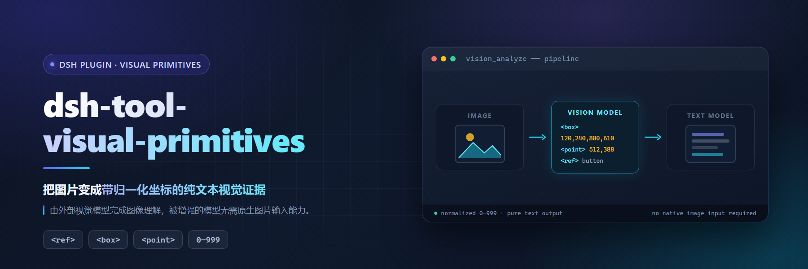
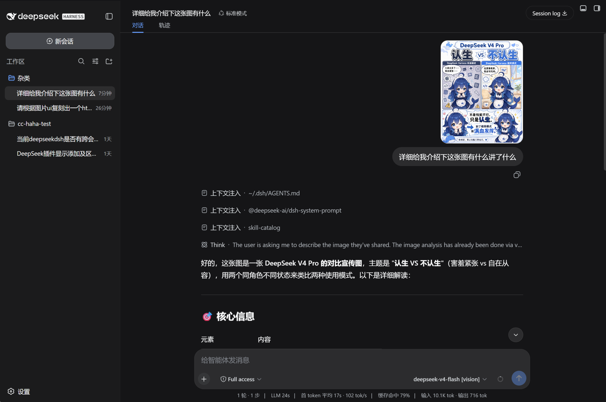
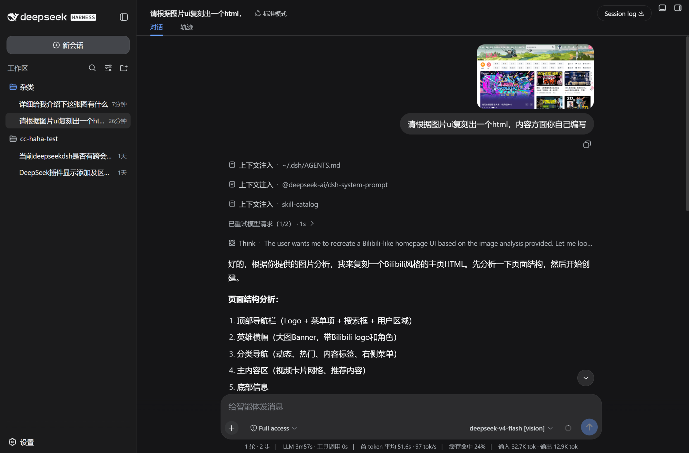
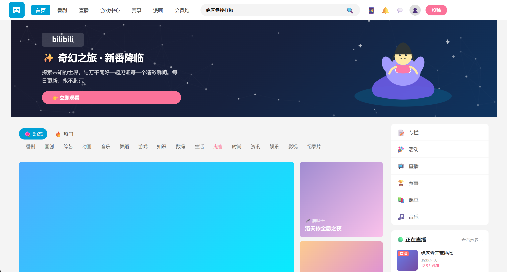

<div align="center">



[**中文**](README.md) · [English](README_EN.md)

<!-- badges -->
[](LICENSE)
[](https://www.npmjs.com/package/dsh-tool-visual-primitives)
[](https://github.com/deepseek-ai/DeepSeek-Harness)
[](#requirements)
[](#the-11-auto-detected-modes)
[](#requirements)
[](#how-it-works)

**Sends an image to an external vision model and returns plain-text visual evidence with spatial references — the enhanced model needs no native image input.**

</div>

---

## What This Is

Text-only models on [DeepSeek Harness (DSH)](https://github.com/deepseek-ai/DeepSeek-Harness) cannot see images. This plugin gives them that capability.

The design is inspired by DeepSeek's [Thinking with Visual Primitives](https://github.com/deepseek-ai/Thinking-with-Visual-Primitives): instead of flattening an image into a vague caption, it emits structured evidence with **normalized coordinates and referenceable objects**, so later reasoning can cite and verify it.

> The package is published on npm. The official DSH one-command install below is recommended; local source mounting remains available for development and local debugging.

## What's New in 1.5.4

- **The `vision_analyze` tool is now restricted to `[vision]` models**: calling it from any other model is explicitly denied with an actionable reason, so models that already accept images no longer have two competing paths.
- **Image URLs now follow 30x redirects**: redirects are followed hop by hop with the SSRF check re-run on each hop. Short-link hosts such as `picsum.photos` previously failed unconditionally.
- **Download failures now report the underlying cause**: error messages include `cause` (e.g. `UND_ERR_CONNECT_TIMEOUT`), distinguishing DNS failures, connect timeouts and TLS errors directly.
- Connect timeout tightened to 5s, plus one bounded retry covering transient connection errors only.

> See [CHANGELOG_EN.md](CHANGELOG_EN.md) for the full release history.

## Highlights

| Capability | Detail |
|---|---|
| 🖼 **Two entry points, one core** | Explicit `vision_analyze` tool calls and `[vision]` chat-model variants share the same pipeline and evidence format |
| 🧠 **11 auto-detected tasks** | Caption · inventory · multi-subject · counting · grounding · spatial relation · comparison · path tracing · topology · UI · document visual, selected automatically from the question |
| 📐 **Visual primitives** | Emits `<ref>`, `<box>`, and `<point>` with normalized `0–999` coordinates, so evidence can be cited and checked by later reasoning; three policies `auto` / `on` / `off` |
| 🎚 **Three detail levels** | `brief` · `standard` (default) · `verbose`, tuning evidence granularity and token cost to the task |
| 🔒 **Enhances only the models you pick** | Adds `[vision]` variants to selected text-only models while originals stay unchanged; models with native image input are greyed out in the selector |
| 💾 **Session-scoped evidence cache** | Follow-ups reuse evidence only when it covers the new task, detail and focus; otherwise the image is read again instead of treating a stale answer as fact |
| 🎛 **Native settings page** | Secure credential storage · connection checks · searchable `/models` discovery · custom model IDs · collapsible provider/model selection |
| 🛡 **Fetch safety** | Remote URLs reject localhost, private ranges and embedded credentials; redirects are re-validated on every hop, up to 5 hops |

## How It Works

```text
Image + user question
        │
        ▼
detectVisionMode() → shouldUsePrimitives() → buildVisionPrompt()
        │
        ▼
External vision model (OpenAI-compatible Chat Completions)
        │
        ▼
Plain-text visual evidence (optionally with primitives)
        │
        ▼
Original text model continues the answer
```

`Mode` and `Detail` are orthogonal: Mode selects the task, while Detail controls information density. `Primitives` decides whether structured spatial evidence is required.

## Requirements

- A working DSH **Web Profile** (DSH `0.1.2-rc.1` or newer is required, verified up to `0.2.1-rc.2`).
- Node.js `>= 20` and pnpm.
- An accessible vision-model service. By default the plugin uses OpenAI-compatible endpoints:
  - `POST <Base URL>/chat/completions`
  - Optional model discovery: `GET <Base URL>/models`

The vision provider and the enhanced text-model provider may be different.

## Installation

### One-command npm install

Run this in PowerShell or a terminal (the `dsh` command below assumes DSH is installed globally via `npm install -g @deepseek-ai/dsh`; without a global install, replace `dsh` with `npx @deepseek-ai/dsh`):

```powershell
dsh plugin --profile web add dsh-tool-visual-primitives@latest
```

The command invokes DSH's official plugin manager and installs the package into the `web` Profile. After installation, DSH detects this package's `dsh.bundle.patch` declaration, adds the plugin to `dsh.profile.bundles`, and applies the package's own `cordis.patch.yml` during boot.

It is safe to run repeatedly: it does not duplicate the bundle and does not directly change the Profile's own `cordis.patch.yml` or other plugin settings, so it can coexist with plugins such as `dsh-better-sidebar`.

If you use a Profile other than `web`, replace `--profile` with that Profile name:

```powershell
dsh plugin --profile <your-profile-name> add dsh-tool-visual-primitives@latest
```

Restart DSH completely after installation, then configure API Key, Base URL, and the vision model under **Settings → Visual Analysis**.

### Install from a Local GitHub Clone

This is the installation path verified for the current release. You may use another source directory if you also update `$source`.

```powershell
$source = 'D:\DSH\dsh-tool-visual-primitives'
git clone https://github.com/InkshadeWoods/dsh-tool-visual-primitives.git $source

Set-Location $source
pnpm install
pnpm run build

dsh plugin --profile web add $source
```

The official DSH CLI adds the local package to the Profile dependencies and maintains `dsh.profile.bundles` from the package's `dsh.bundle.patch` declaration. No manual edit of the Profile's `package.json` or `cordis.patch.yml` is needed.

Restart DSH completely:

```powershell
dsh web
```

When the client UI changes for the first time, force-refresh the browser with `Ctrl+Shift+R`.

### Uninstall

If you also want to remove the saved API key, select **Clear API Key** in the plugin settings first. Then run DSH's official uninstall command:

```powershell
dsh plugin --profile web remove dsh-tool-visual-primitives
```

DSH removes the package dependency and automatically removes its bundle from `dsh.profile.bundles`. Restart DSH when it completes.

## First-Time Setup

Open **Settings → Vision Analysis** in DSH, then:

1. Enter the **API Key**, **Base URL**, and vision model.
2. Select **Load models** to retrieve `<Base URL>/models`; the list is searchable.
3. If the service does not expose a model directory, enter a **Custom model ID** instead.
4. Select **Test connection**.
5. Configure analysis parameters, then choose the text-only chat models that should receive a `[vision]` variant.

Saved API keys are never shown again when the page is reopened. Entering a new value replaces the old key; **Clear API Key** removes it.

### API and Model Discovery

| Item | Behavior |
| --- | --- |
| Vision request | `POST <Base URL>/chat/completions` with `Authorization: Bearer <API Key>` |
| Model discovery | `GET <Base URL>/models` with `Accept: application/json` and the same API key |
| Discovery failure | A custom model ID remains available and does not prevent vision analysis |
| Xiaomi Mimo URLs | The plugin automatically uses the `api-key` header |

## Analysis Parameters

| Setting | Options / default | Purpose |
| --- | --- | --- |
| Visual primitives | `auto` / `on` / `off` (default: `auto`) | `auto` decides from Mode and Detail; `on` forces coordinate-based evidence; `off` requests plain-text evidence only. |
| Analysis detail | `brief` / `standard` / `verbose` (default: `standard`) | Controls output density; it does not alter task detection. |
| Retry mode | `off` / `on` / `format-only` (default: `off`) | When required primitives are missing, `on` re-reads the image; `format-only` preserves conclusions where possible and repairs formatting. |
| Maximum image size | `10 MB` | Applies to local files, remote images, and chat attachments. |
| Timeout | `180000 ms` | Maximum wait for one vision-model request. |
| Output-token budget | `auto` or manual (default: `auto`) | `auto` follows Detail: brief `1024`, standard `2048`, verbose `4096`. |
| Diagnostics log | `off` / `on` (default: `off`) | When enabled, plugin runtime logs are printed to the DSH console for troubleshooting. |

## The 11 Auto-Detected Modes

| Mode | Best for | Evidence focus |
| --- | --- | --- |
| `caption` | "What is this image?" | Overall summary and key objects |
| `object_inventory` | "What objects are present?" | Main-object list and positions |
| `multi_subject` | "Who is shown left to right?" | Subject ordering, features, and positions |
| `counting` | "How many buttons?" | Candidates, exclusions, and count |
| `grounding` | "Where is the red button?" | Target and candidate locations |
| `spatial_relation` | "Which side is A on?" | Relative position, occlusion, containment |
| `comparison` | "Compare these two areas" | Dimensions and visible evidence for each side |
| `path_tracing` | "How does the route go?" | Start, key points, end, uncertainty |
| `topology` | "Is the maze solvable?" | Connectivity, blockers, and conclusion |
| `ui_analysis` | "How do I use this screen?" | UI elements, state, location, next step |
| `document_visual` | "Explain this chart/poster" | Headings, text blocks, tables, reading order |

The highest-priority keyword match wins; `caption` is used when nothing matches. For example, "How many buttons are on this screen?" selects `ui_analysis` and then applies the selected Detail level.

## Usage

### Option 1: Chat with a `[vision]` Model

1. In **Chat visual models** settings, enable a text-only model.
2. Reopen the model list and select the new `Model name [vision]` entry.
3. Upload, paste, or drop an image, then ask your question normally.

The plugin replaces only image blocks with visual-evidence text. The selected original text model still produces the final answer.

For a follow-up that explicitly refers to the latest image, the plugin checks whether cached evidence covers the new task, detail level, and requested objects/locations. It re-analyzes the image when coverage is insufficient rather than treating an incomplete previous answer as fact.

### Option 2: Explicit `vision_analyze` Tool

The tool accepts **exactly one** image source: a local absolute path or an HTTP(S) URL.

```json
{
  "image_path": "D:/images/dashboard.png",
  "prompt": "Count the main clickable buttons and identify their positions"
}
```

```json
{
  "url": "https://example.com/chart.png",
  "prompt": "Explain the chart trend and identify unreadable labels"
}
```

Remote URLs cannot target localhost, private-network addresses, or include credentials. Redirects are followed (up to 5 hops) so that short-link image hosts work, but the checks above are re-run on every hop — automatic following would let a redirect reach beyond what the first-hop check cleared, so hops are followed manually. Supporting redirects does not widen the server-side request forgery surface.

**This tool is available to `[vision]` models only.** Calling it from any other model is explicitly denied, with a message stating the active provider, suggesting the model use its own image capability, and explaining how to switch to a `[vision]` model. This keeps models that already accept images from having two competing paths ("look at it directly" versus "external pipeline"). The denial happens before the tool runs and produces no upstream call.

When no conversation vision model is configured (bridge disabled) no `[vision]` model can be selected, so the restriction is not installed and the tool stays open to every model.

### Evidence Format

When primitives are enabled, the external vision model is instructed to return evidence under these headings:

```text
[Mode]
[Visual Primitives]
[Observations]
[Relations]
[Uncertainty]
[Answer]
```

Location evidence looks like this:

```text
<ref>submit_button</ref><box>[[742, 861, 900, 930]]</box>
<point>[[125, 430], [210, 430], [300, 510]]</point>
```

All coordinates are relative `0–999` values, not source-image pixels.

## Verified End-to-End Scenarios

All assets and results are in [`test/`](test/).

| Scenario | Verified outcome |
| --- | --- |
| Chat image understanding | A `[vision]` model successfully read a DSH usage-mode comparison image and supplied a structured description to the text model. |
| Screenshot-driven UI recreation | A `[vision]` model interpreted a Bilibili home-page screenshot; the text model then generated an independent Bilibili-style HTML page from that evidence. |

**Image-understanding result**



**UI recreation flow and result**





These outcomes validate the current end-to-end chain. Generated results still depend on the external vision model, text model, prompt, and image quality.

## Development

```powershell
pnpm install
pnpm run build
```

`pnpm run build` generates the client bundle at `lib/client.js`.

- The server entry is `index.mjs`; restart DSH after changing it.
- After changing the client UI, rebuild the package and force-refresh the browser page.

## License

[MIT](LICENSE)

## Acknowledgements and References

- [Thinking with Visual Primitives](https://github.com/deepseek-ai/Thinking-with-Visual-Primitives)
- [DeepSeek Harness](https://github.com/deepseek-ai/DeepSeek-Harness)
- The provider-bridge design draws inspiration from [modlens](https://github.com/liustack/modlens)
